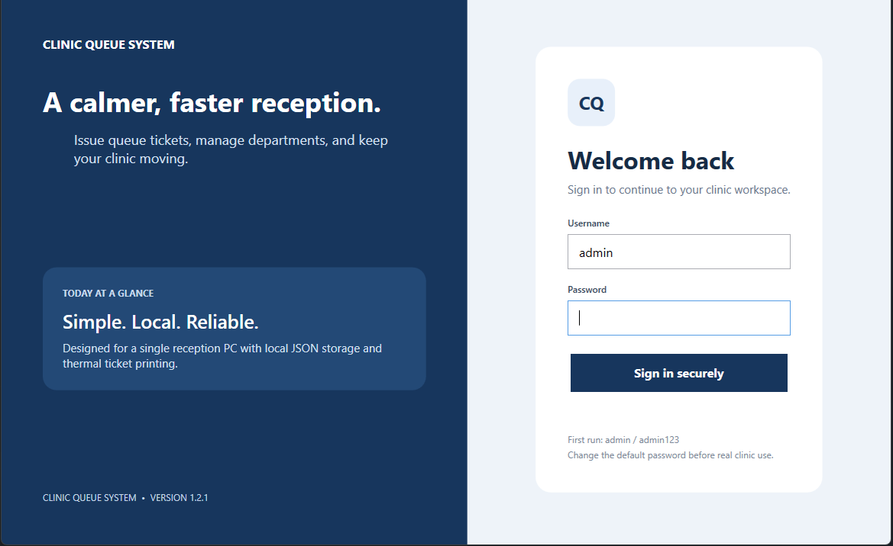
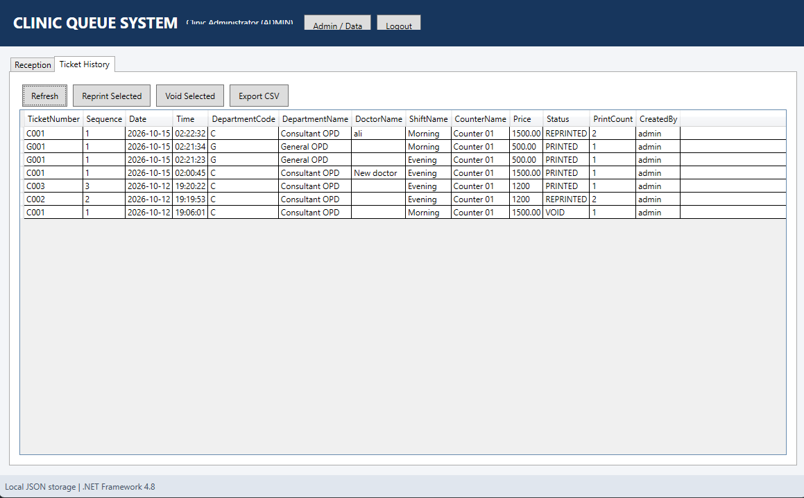
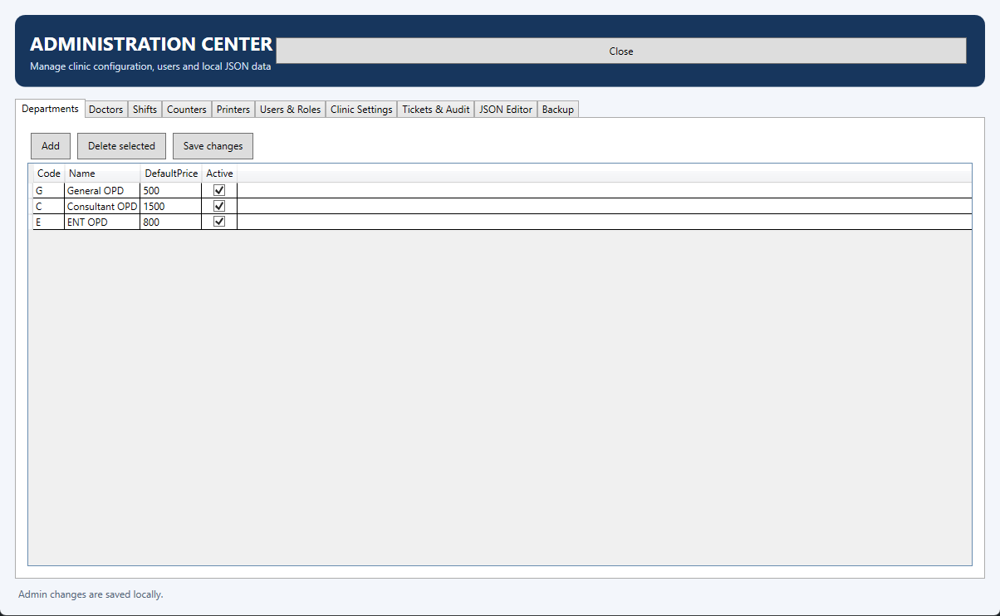
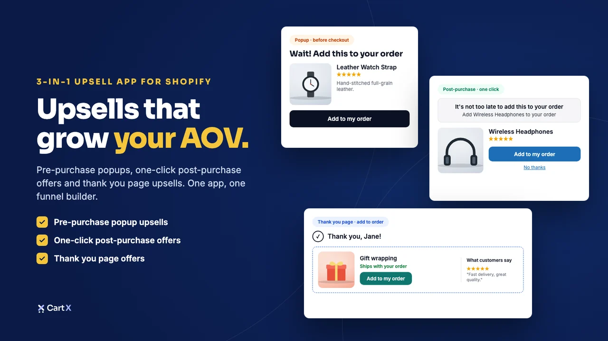
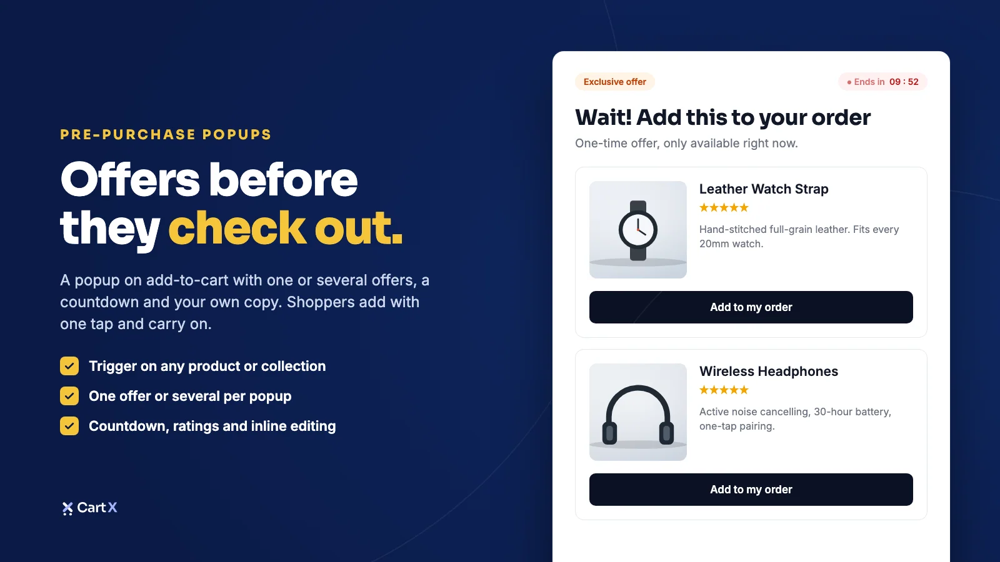
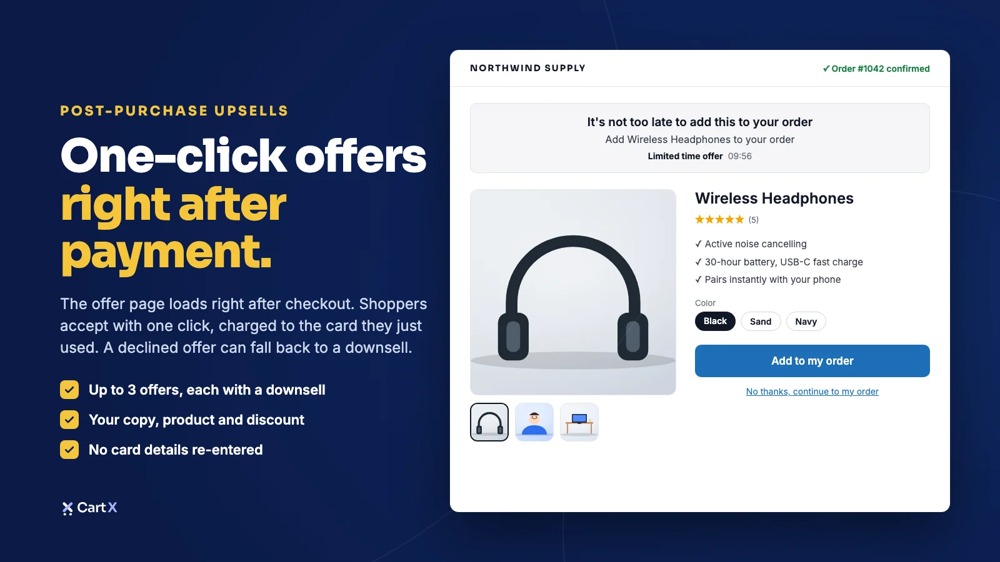
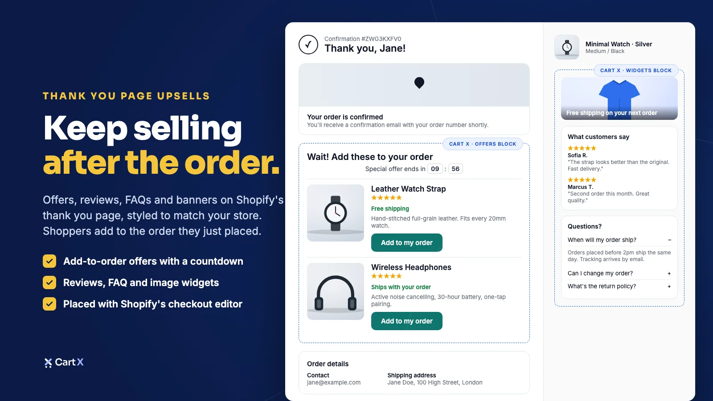
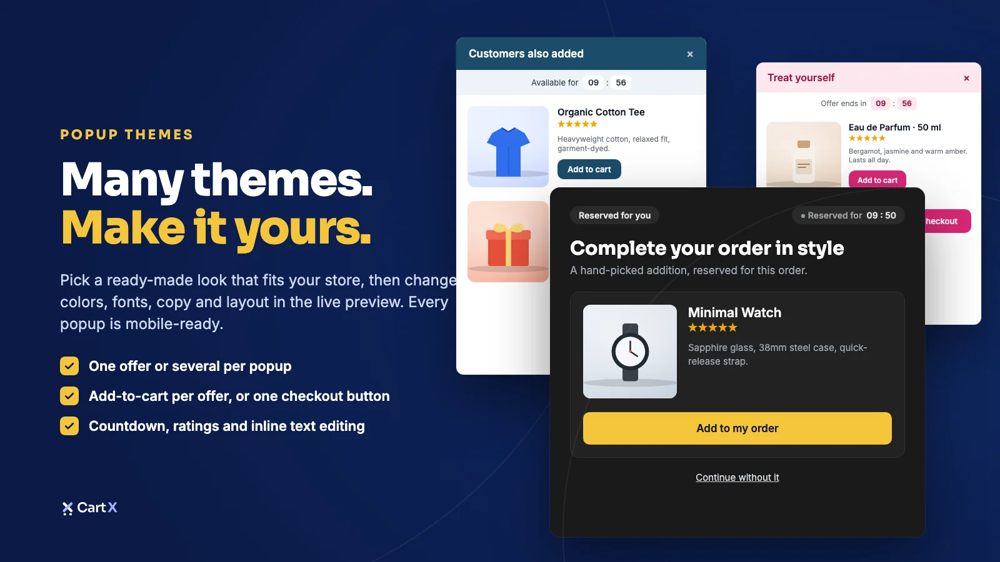

# Web Application Portfolio Projects

This file contains portfolio summaries for web application projects, prepared for use in a portfolio

## Clinic Queue System WPF + JSON v1.2.1

A C# WPF desktop application for clinic queue management, built with XAML and targeting .NET Framework 4.8. The application uses local JSON file storage and does not require SQL Server, SQLite, or a separate database server.

- **Project title:** Clinic Queue System | C# WPF Desktop Application
- **Your role:** C# Desktop Application Developer
- **Project type:** Windows Desktop Application
- **Technologies:** C#, WPF, XAML, .NET Framework 4.8, JSON
- **Target platform:** Windows 10
- **Development environment:** Visual Studio 2026
- **Data storage:** Local JSON file
- **Skills and deliverables:** C#, WPF, XAML, .NET Framework, JSON
- **Code:** https://github.com/syedalinaqihasni/Clinic-Queue-System-WPF/

### Project description

Developed a Windows desktop application for clinic queue management using C#, WPF, and XAML. Built for .NET Framework 4.8, the application uses local JSON files for data storage, eliminating the need for a separate database server. Designed for Windows 10 with a focus on a desktop-based workflow and straightforward local data management.

### Screenshots

## CartX

- **Project title:** CartX | Shopify App UI Modernization
- **Your role:** React Developer
- **Project type:** Shopify application redesign and frontend migration
- **Technologies:** Shopify, React.js
- **Skills and deliverables:** React.js, Shopify, Frontend Development, Web Application Redesign, UI Development
- **Code:** Repo link not Available

**Project description**

Redesigned CartX and modernized its application frontend by moving from a PHP/Laravel-based implementation toward a React-based architecture. Focused on improving the user interface and creating a more modern, maintainable frontend experience. Adjust the wording to match the exact scope of the migration you completed.

### Screenshots

## eSpark Talent Dashboard

- **Project title:** eSpark Talent Dashboard | Next.js & React Web Application
- **Your role:** Frontend Developer
- **Project type:** Talent and workforce management dashboard
- **Technologies:** Next.js, React.js, State Management
- **Skills and deliverables:** Next.js, React.js, Frontend Development, State Management, Responsive Web Design
- **Code:** Repo link not Available

**Project description**

Developed a modern talent management dashboard for employers, employees, and HR teams. Focused on building a responsive frontend, organizing management workflows into a clear interface, and using React and Next.js to support a smooth user experience across screen sizes.

### Screenshots
- Coming Soon

## Real Buyerz

- **Project title:** Real Buyerz | Real Estate Portal
- **Your role:** Frontend Developer
- **Project type:** Online real estate portal
- **Technologies:** Next.js, React.js, State Management
- **Skills and deliverables:** Next.js, React.js, Frontend Development, State Management, Responsive Web Design
- **Code:** Repo link not Available

**Project description**

Built a real estate portal designed for real estate agents and everyday users. Focused on a user-friendly interface, clear presentation of portal information, and a React-based frontend using Next.js and state management to support an organized browsing experience.

### Screenshots
- Coming Soon
