# Website Development Portfolio Projects

This file contains portfolio project summaries prepared for an Upwork profile.

## 1. Apollo Boxing & Fitness

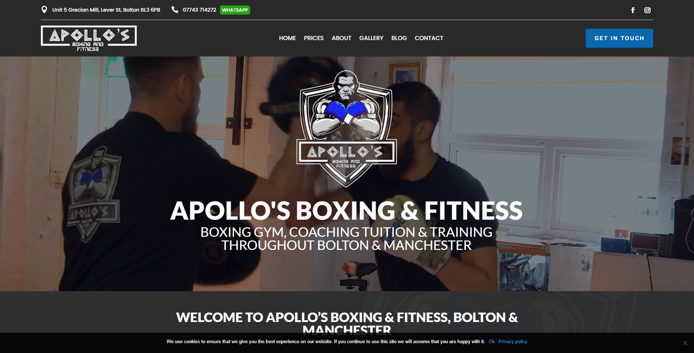

- **Project title:** Apollo Boxing & Fitness | WordPress Website Development
- **Your role:** WordPress Developer
- **Website:** https://apollosboxing.co.uk
- **Business:** Apollo Boxing & Fitness
- **Project type:** New website development
- **Platform:** WordPress
- **Portfolio category:** Web Development
- **Skills and deliverables:** WordPress, Website Development, Responsive Web Design, Website Design, CMS Development

**Project description**

Designed and developed a new WordPress website for Apollo Boxing & Fitness, creating a professional online presence for the boxing and fitness business. Focused on a clean, user-friendly layout, clear presentation of services, and responsive design for desktop, tablet, and mobile visitors.

## 2. Be One Solution

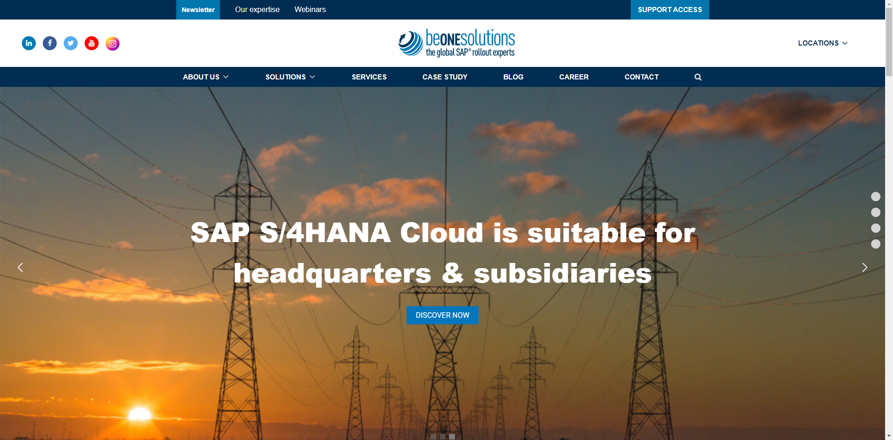

- **Project title:** Be One Solution | Corporate WordPress Website
- **Your role:** WordPress Developer
- **Website:** https://beonesolution.com
- **Business:** Be One Solution
- **Project type:** New corporate website development
- **Platform:** WordPress
- **Portfolio category:** Web Development
- **Skills and deliverables:** WordPress, Website Development, Corporate Website Design, Responsive Web Design, CMS Development

**Project description**

Created a professional corporate website for Be One Solution using WordPress. Focused on a clean layout, clear business presentation, user-friendly navigation, and responsive design to establish a strong online presence and help visitors explore the company's services.

## 3. Bill Advice

- **Project title:** Bill Advice | Website Development & Design
- **Your role:** Website Developer
- **Website:** https://billadvice.co.uk
- **Business:** Bill Advice
- **Project type:** Website development — confirm exact scope
- **Platform:** Confirm platform
- **Portfolio category:** Web Development
- **Skills and deliverables:** Website Development, Website Design, Responsive Web Design, CMS Development, Content Management

**Project description**

Prepared a professional online presence for Bill Advice, with an emphasis on clear information, user-friendly navigation, and a structured browsing experience across desktop and mobile devices. Confirm the exact work completed and platform before publishing.

## 4. CMS Spares

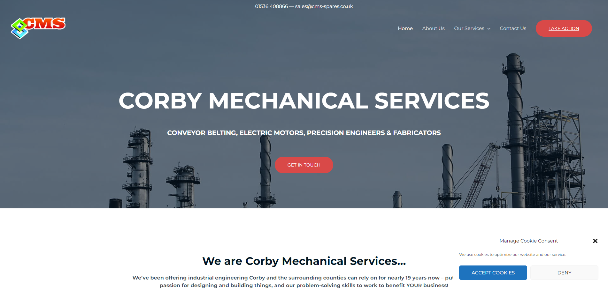

- **Project title:** CMS Spares | Corporate WordPress Website Development
- **Your role:** WordPress Developer
- **Website:** https://cms-spares.co.uk
- **Business:** CMS Spares
- **Project type:** New corporate website development
- **Platform:** WordPress
- **Portfolio category:** Web Development
- **Skills and deliverables:** WordPress, Corporate Website Development, Website Design, Responsive Web Design, CMS Development

**Project description**

Created a corporate WordPress website for CMS Spares, focusing on professional business presentation, structured content, and intuitive navigation. Developed a responsive layout to help visitors access company information and explore its offerings across devices.

## 5. Conti di San Bonifacio

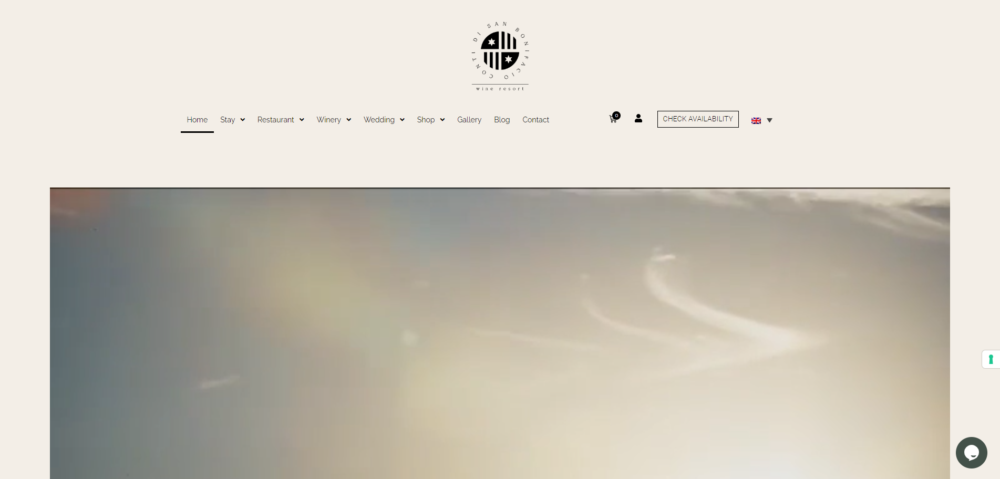

- **Project title:** Conti di San Bonifacio | Wine Website Maintenance
- **Your role:** WordPress Website Maintenance Specialist
- **Website:** https://contidisanbonifacio.com
- **Business:** Conti di San Bonifacio
- **Project type:** Website maintenance
- **Platform:** Confirm platform
- **Portfolio category:** Web Development
- **Skills and deliverables:** Website Maintenance, Website Content Management, Website Troubleshooting, Website Optimization, CMS Management

**Project description**

Provided website maintenance support for Conti di San Bonifacio, a wine and hospitality brand. Focused on maintaining the site's presentation, keeping content organized, and supporting a smooth user experience while preserving the brand's online identity.

## 6. Glitzy Glasses

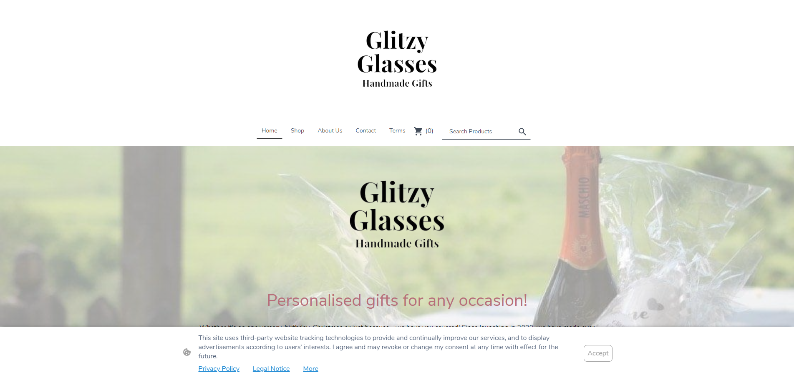

- **Project title:** Glitzy Glasses | WordPress E-commerce Store
- **Your role:** WordPress & E-commerce Developer
- **Website:** https://glitzyglasses.co.uk
- **Business:** Glitzy Glasses
- **Project type:** E-commerce website development
- **Platform:** WordPress (WooCommerce, if applicable)
- **Portfolio category:** E-commerce Development
- **Skills and deliverables:** WordPress, WooCommerce, E-commerce Development, Product Page Design, Responsive Web Design

**Project description**

Developed an online glasses store for Glitzy Glasses using WordPress, emphasizing appealing product presentation, user-friendly shopping, and responsive design to support customers browsing the store on different devices.

## 7. Haylets Communicate

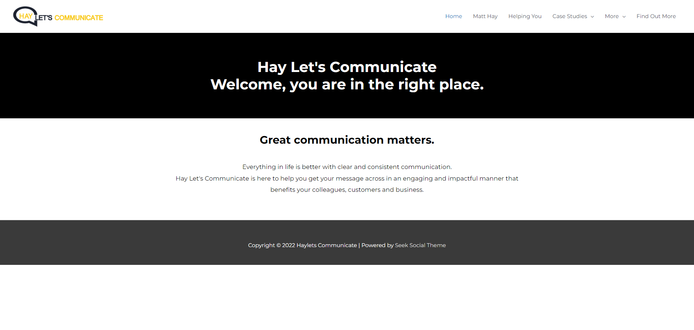

- **Project title:** Haylets Communicate | Website Development
- **Your role:** Website Developer
- **Website:** https://hayletscommunicate.com
- **Business:** Haylets Communicate
- **Project type:** Confirm exact project scope
- **Platform:** Confirm platform
- **Portfolio category:** Web Development
- **Skills and deliverables:** Website Development, Website Design, Responsive Web Design, User Interface Design, Content Management

**Project description**

Worked on the Haylets Communicate website to create or improve its online presence. Focused on clear content presentation, a professional layout, intuitive navigation, and responsive browsing. Update this description to match the exact work performed.

## 8. Senior Waste

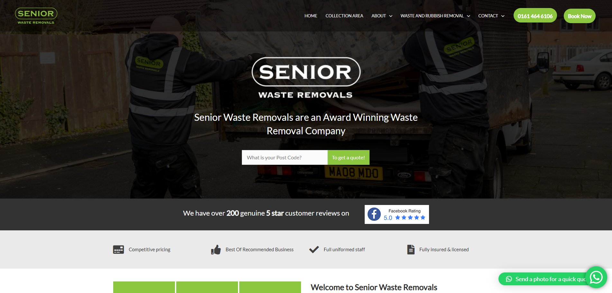

- **Project title:** Senior Waste | Waste Management Company Website
- **Your role:** Website Developer
- **Website:** https://seniorwaste.com
- **Business:** Senior Waste
- **Project type:** Company website development
- **Platform:** Confirm platform
- **Portfolio category:** Web Development
- **Skills and deliverables:** Website Development, Business Website Design, Responsive Web Design, CMS Development, Content Management

**Project description**

Developed a professional website for Senior Waste, a waste management business. Focused on presenting company services clearly, organizing business information, and creating a responsive website that helps potential customers understand its offerings and contact the business.

## 9. Shop DND

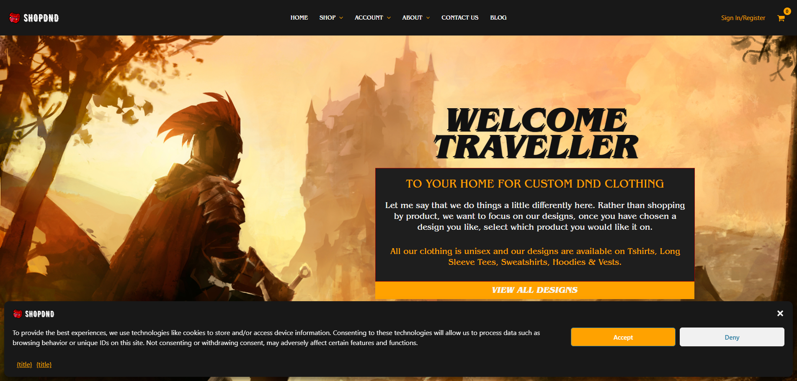

- **Project title:** Shop DND | WooCommerce T-Shirt Store
- **Your role:** WordPress & WooCommerce Developer
- **Website:** https://shop-dnd.com
- **Business:** Shop DND
- **Project type:** Online clothing store development
- **Platform:** WordPress and WooCommerce
- **Portfolio category:** E-commerce Development
- **Skills and deliverables:** WordPress, WooCommerce, E-commerce Development, Product Page Design, Responsive Web Design

**Project description**

Created an online T-shirt store for Shop DND using WooCommerce. Focused on product presentation, store navigation, and a straightforward shopping experience to help customers browse apparel and explore available products across desktop and mobile devices.

## 10. Faith Lets Grow

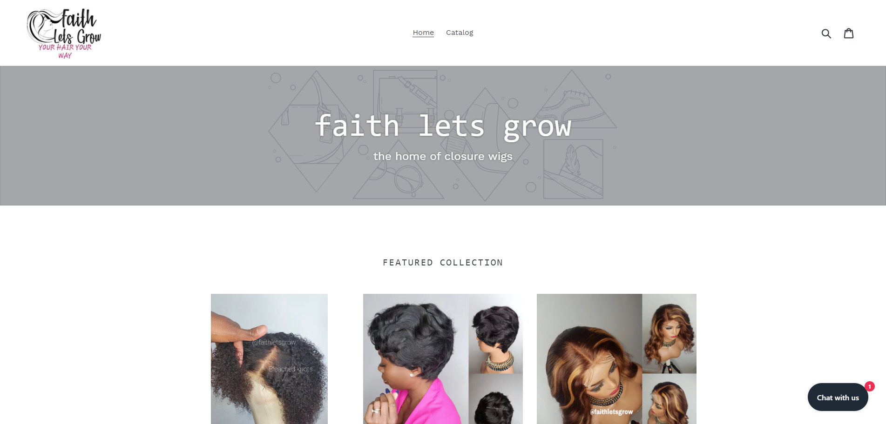

- **Project title:** Faith Lets Grow | Church Website Redesign
- **Your role:** WordPress Website Designer & Developer
- **Website:** https://faithletsgrow.com
- **Business:** Faith Lets Grow
- **Project type:** Church website redesign
- **Platform:** Confirm platform
- **Portfolio category:** Web Development
- **Skills and deliverables:** Website Redesign, Website Development, Responsive Web Design, User Interface Design, CMS Development

**Project description**

Redesigned the Faith Lets Grow website to create a welcoming online presence for the church community. Focused on improving the layout, organizing information, and making navigation more intuitive while delivering a responsive experience for visitors using different devices.

## 11. InsureMe4Less

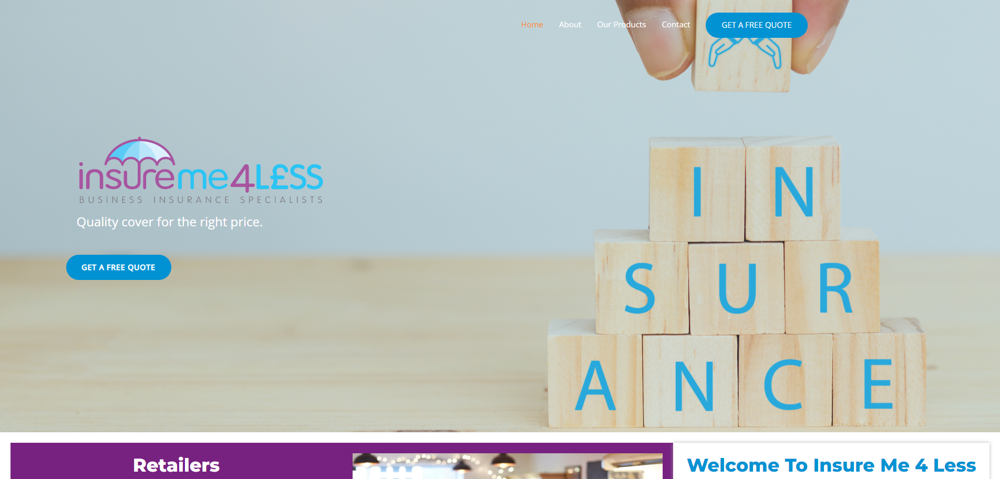

- **Project title:** InsureMe4Less | Insurance Consultancy Website
- **Your role:** Website Developer
- **Website:** https://insureme4less.co.uk
- **Business:** InsureMe4Less
- **Project type:** New insurance consultancy website
- **Platform:** Confirm platform
- **Portfolio category:** Web Development
- **Skills and deliverables:** Website Development, Corporate Website Design, Responsive Web Design, CMS Development, Content Management

**Project description**

Created a professional website for InsureMe4Less, an insurance consultancy business. Focused on presenting services clearly, establishing a trustworthy online presence, and providing straightforward navigation so visitors can explore information and find contact details.

## 12. Inteligex

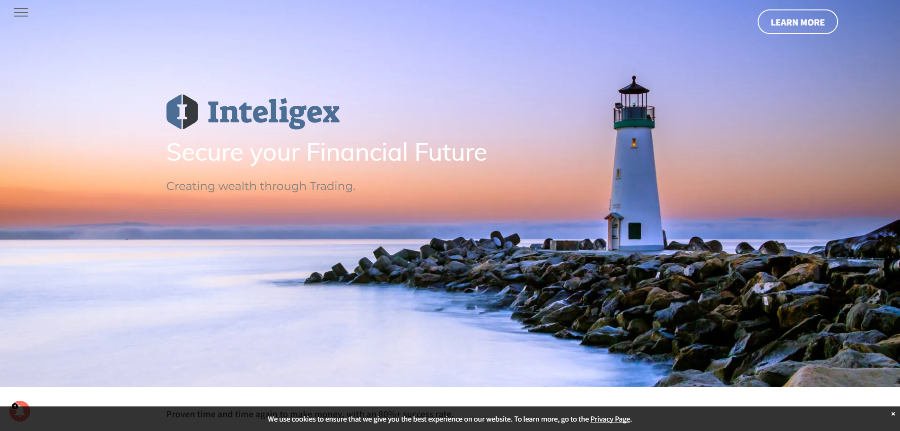

- **Project title:** Inteligex | Corporate WordPress Website Development
- **Your role:** WordPress Developer
- **Website:** https://inteligex.co.uk
- **Business:** Inteligex
- **Project type:** New corporate website development
- **Platform:** WordPress
- **Portfolio category:** Web Development
- **Skills and deliverables:** WordPress, Corporate Website Development, Website Design, Responsive Web Design, CMS Development

**Project description**

Developed a corporate WordPress website for Inteligex with a focus on professional branding, structured content, and user-friendly navigation. Created a responsive online presence to communicate the company's offering and make key information accessible across devices.

## 13. Ion Energy Solutions

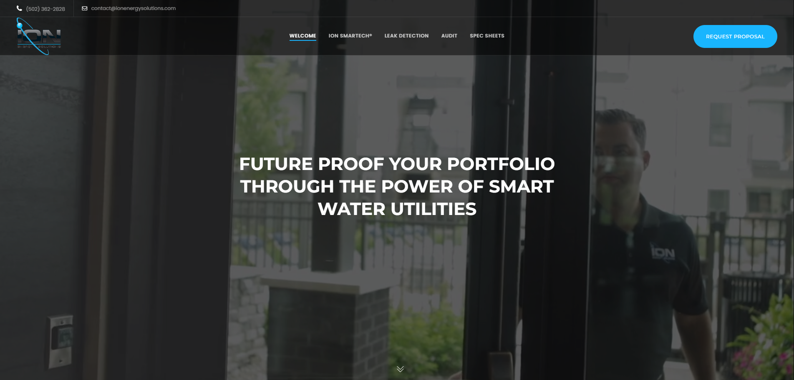

- **Project title:** Ion Energy Solutions | IoT Energy Monitoring Website
- **Your role:** Website Developer
- **Website:** https://ionenergysolutions.com
- **Business:** Ion Energy Solutions
- **Project type:** Company website development
- **Platform:** Confirm platform
- **Portfolio category:** Web Development
- **Skills and deliverables:** Website Development, Corporate Website Design, Responsive Web Design, Technology Website Design, CMS Development

**Project description**

Developed a professional website for Ion Energy Solutions, a company focused on IoT-based electricity monitoring. Focused on communicating the company's technology and services through clear content, a modern business-oriented design, and responsive layouts.

## 14. Lime Tree London

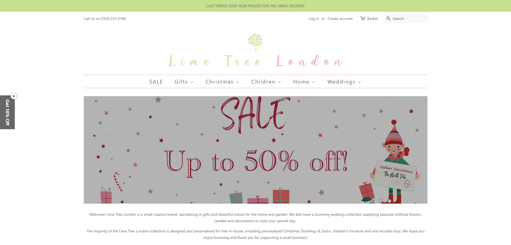

- **Project title:** Lime Tree London | Christmas E-commerce Website
- **Your role:** WordPress & E-commerce Developer
- **Website:** https://limetreelondon.com
- **Business:** Lime Tree London
- **Project type:** Christmas e-commerce website development
- **Platform:** Confirm platform
- **Portfolio category:** E-commerce Development
- **Skills and deliverables:** E-commerce Development, WooCommerce, Website Design, Product Page Design, Responsive Web Design

**Project description**

Worked on an e-commerce website for Lime Tree London, focused on presenting seasonal Christmas products through an appealing online shopping experience. Emphasized product presentation, intuitive navigation, and responsive layouts to help customers explore the store.

## 15. Live Well Nutrition UK

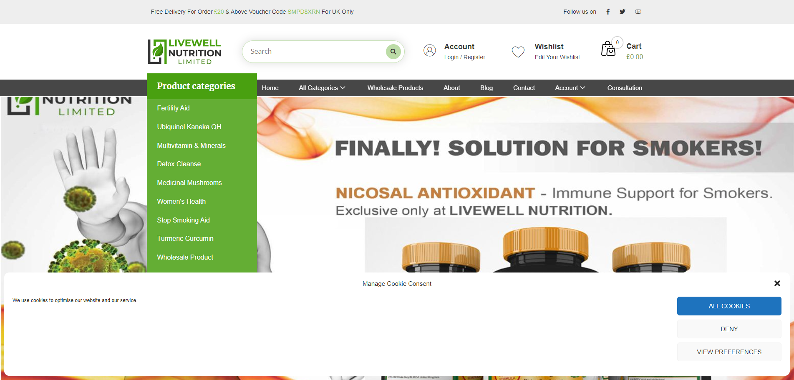

- **Project title:** Live Well Nutrition UK | Nutrition Website
- **Your role:** Website Developer
- **Website:** https://livewellnutritionuk.com
- **Business:** Live Well Nutrition UK
- **Project type:** Confirm exact project scope
- **Platform:** Confirm platform
- **Portfolio category:** Web Development
- **Skills and deliverables:** Website Development, Website Design, Responsive Web Design, Content Management, User Interface Design

**Project description**

Worked on the Live Well Nutrition UK website to support a professional online presence for a nutrition-focused business. Focused on clear information architecture, accessible content presentation, and responsive design. Update the scope to reflect the exact work performed.

## 16. Luner

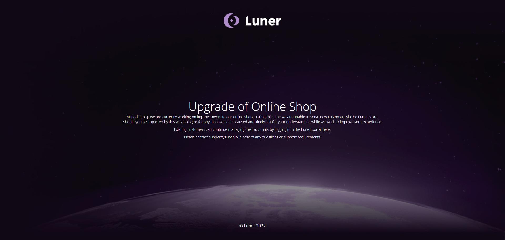

- **Project title:** Luner | IoT SIM Website Development
- **Your role:** Website Developer
- **Website:** https://luner.com
- **Business:** Luner
- **Project type:** IoT SIM website development
- **Platform:** Confirm platform
- **Portfolio category:** Web Development
- **Skills and deliverables:** Website Development, Corporate Website Design, Responsive Web Design, Technology Website Design, CMS Development

**Project description**

Developed a business website for Luner, focused on IoT SIM connectivity solutions. Structured the website to present the company's services and technology offering clearly, with professional design, straightforward navigation, and a responsive experience.

## 17. Timeless Treatments

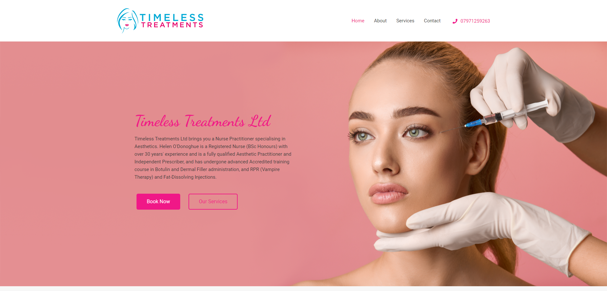

- **Project title:** Timeless Treatments | Cosmetic Surgery Website
- **Your role:** Website Developer
- **Website:** https://timeless-treatments.co.uk
- **Business:** Timeless Treatments
- **Project type:** Cosmetic treatment website development
- **Platform:** Confirm platform
- **Portfolio category:** Web Development
- **Skills and deliverables:** Website Development, Website Design, Responsive Web Design, Service-Based Website Design, CMS Development

**Project description**

Created a professional website for Timeless Treatments, a cosmetic treatment and surgery-related business. Focused on polished visual presentation, clear service information, and user-friendly navigation to help visitors explore the business's offerings across desktop and mobile devices.

## 18. Travel Trade Ready

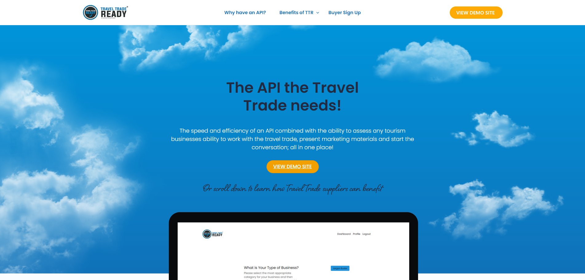

- **Project title:** Travel Trade Ready | Multilingual Travel Website
- **Your role:** Website Developer
- **Website:** https://traveltradeready.net
- **Business:** Travel Trade Ready
- **Project type:** Multilingual travel website development
- **Platform:** Confirm platform
- **Portfolio category:** Web Development
- **Skills and deliverables:** Multilingual Website Development, Website Development, Responsive Web Design, CMS Development, Website Design

**Project description**

Developed a multilingual website for Travel Trade Ready, a travel industry business. Focused on organizing content for different language audiences, creating intuitive navigation, and delivering a responsive browsing experience for an international audience.

## 19. Watt

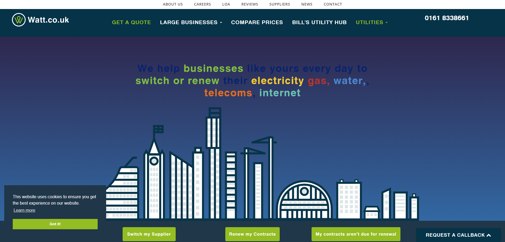

- **Project title:** Watt | Electricity Power Management Website
- **Your role:** Website Developer
- **Website:** https://watt.co.uk
- **Business:** Watt
- **Project type:** Corporate website development
- **Platform:** Confirm platform
- **Portfolio category:** Web Development
- **Skills and deliverables:** Website Development, Corporate Website Design, Responsive Web Design, CMS Development, Website Design

**Project description**

Developed a professional corporate website for Watt, a company operating in electricity and power management. Focused on presenting services and business information clearly through a modern layout, structured content, and responsive design.
